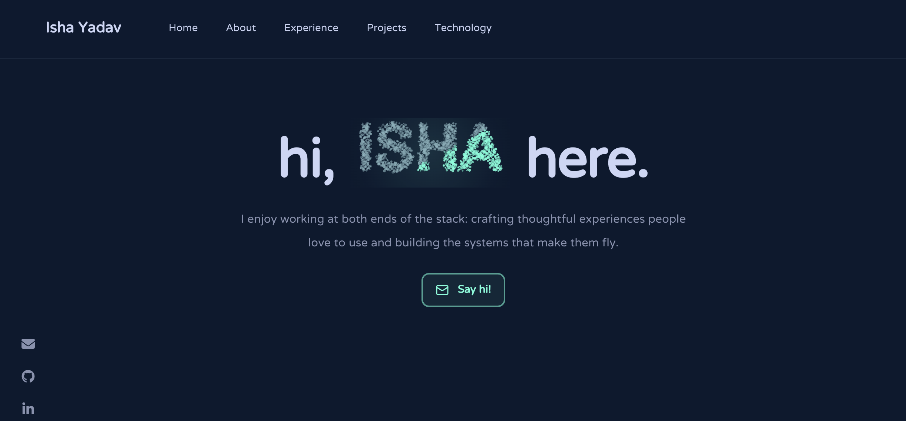

<div align="center">



# Isha Yadav — Portfolio

**Software engineer · NIT Silchar**

A personal site for my experience, projects, and the things I love building.

</div>

## ✨ About

I’m a Computer Science graduate from **NIT Silchar** (CGPA: 9.34) and have
interned at **UKG** and **Microsoft**, working on frontend development,
application security, and systems software.

The portfolio is a frontend-only React and Vite application.

## 🛠 Set up

Requires **Node.js** and **npm**:

```sh
npm install
npm run dev
```

Open the local URL printed by Vite, usually `http://localhost:5173`.

## 🚀 Build and lint

```sh
npm run build
npm run lint
```


## 🎨 Color palette

| Color | Hex |
| --- | --- |
| Navy |  `#0a192f` |
| Light navy |  `#112240` |
| Lightest navy |  `#233554` |
| Slate |  `#8892b0` |
| Light slate |  `#a8b2d1` |
| Lightest slate |  `#ccd6f6` |
| Accent green |  `#64ffda` |
